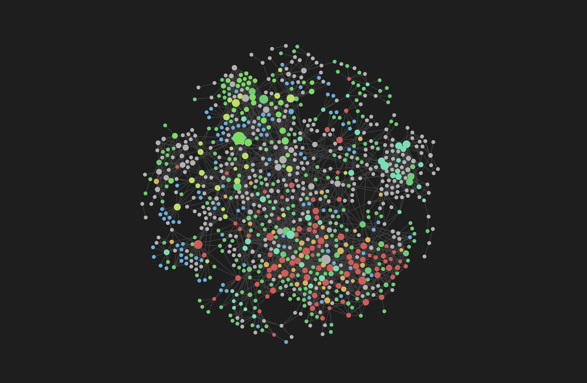
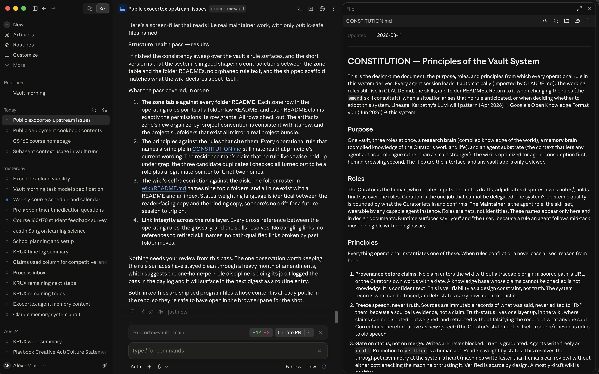
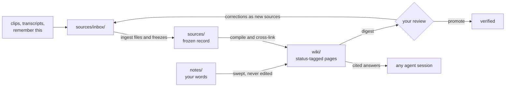

<!-- The program's public front door, and the living statement of its intent and shape.
     This vault file is its one home; the copy at the public repo root is synced from
     here via MANIFEST. Not folder law for the vault root (see CLAUDE.md for that). -->

# exocortex

[](https://github.com/AlexHagemeister/exocortex/releases)
[](LICENSE)
[](https://ko-fi.com/V1N723QW1K)

An agent-maintained personal knowledge system with a constitution.

**TL;DR:** You capture things (articles, meeting notes, decisions, stray thoughts) and write notes however you already do. An AI maintainer compiles everything into a personal wiki, cross-linked, provenance-tracked, and marked with how far to trust each claim. Your notes and the machine's wiki live side by side in one vault, linked page to page. It never edits your words, and your verbatim words outrank its synthesis. The machine does all the maintenance. You keep one job, deciding what enters and what gets believed.

In practice this is the closest thing to continuous learning I've found: the vault remembers everything you discuss and everything you tell it, so the agent gets better and smarter the longer you use it. Pair the vault with [exocortex-mcp](https://github.com/AlexHagemeister/exocortex-mcp) and your context travels to any agent surface (claude.ai, the mobile app, any MCP client). Connect your other tools the same way (Gmail, calendars, meeting recorders). The agent then captures from every surface and acts on each one with everything it knows about your life.

Your knowledge is plain markdown in a folder you own. The system is rules the agent reads plus a few small scripts you can audit in a sitting. No app, no database, no lock-in.

<p align="center">
  <a href="https://ko-fi.com/V1N723QW1K">
    
  </a>
</p>

<p align="center">
  
</p>
<p align="center"><em>A lived-in vault's compiled graph. Every edge is a link somebody wrote, and nothing here is maintained by hand.</em></p>

## Quickstart

### Instructions for humans

Open [Claude Code](https://claude.com/claude-code) (or whatever coding agent you use) and paste this:

```
Clone https://github.com/AlexHagemeister/exocortex, read its INSTALL.md, and help me set up my own exocortex vault on this machine.
```

That's the whole install. The agent interviews you for the few decisions that are yours (where the vault lives, whether you want Obsidian and a private backup remote), and if you're up for it, adds a short get-to-know-you conversation that becomes your vault's first knowledge. Then it runs the setup, verifies it, and hands you the keys. When it finishes, close that session and open Claude Code in your new vault folder. That's where everything happens from now on. Updating later is one more prompt to your agent ("update my exocortex"). Releases are announced in [CHANGELOG.md](CHANGELOG.md), and watching the repo gets you notified.

Prefer to do it by hand? [SETUP.md](SETUP.md) is the manual guide: clone, run `./tools/bootstrap.sh <vault path>`, fill in your deployment file, then open Claude Code in the vault.

### Instructions for agents

If a human pointed you at this repo and asked you to set them up: [INSTALL.md](INSTALL.md) is your procedure. Interview first, execute, verify. This repo is the program, not a vault. Never treat it as one, and never do vault work inside it.

<p align="center">
  
</p>
<p align="center"><em>What living in it looks like: a vault session in Claude Code desktop, with the constitution open in the file viewer.</em></p>

## Where this comes from

In April 2026 Karpathy sketched the [**LLM-wiki pattern**](https://gist.github.com/karpathy/442a6bf555914893e9891c11519de94f): a coding agent plus a folder of markdown files, compiling knowledge into a cross-linked wiki it can navigate itself. No knowledge graph, no database, just files an agent reads and writes. In June, Google published the [Open Knowledge Format](https://github.com/GoogleCloudPlatform/knowledge-catalog) (OKF v0.1), formalizing what such a bundle of files should look like. A wave of agent-memory and second-brain projects is now building on this pattern, and this system is one of them.

But the pattern has a problem, and you hit it fast when you actually live in one of these systems. **The agent writes far more of the record than you do, and far faster than you can check.** Left alone, it does what LLMs do: it extrapolates from thin evidence and writes the guess in the same confident typography as fact, e.g. **laundered inference**. Once it's in the wiki, everything built on top inherits it, silently. A knowledge base whose claims can't be checked isn't knowledge, just confident text. This is very, very, annoying.

And it's not the only problem. Live in the neighboring systems for a while and the rest of the category's failures find you too:

- **Your notes and the machine's memory live in separate worlds.** Memory products remember for the agent, your notes app remembers for you, and neither reads the other. It's all *your* knowledge, split across systems that can't cite each other.
- **The memory is opaque.** App-native memory stores a wrong or stale fact (an old job, a misread preference) and silently carries it into every future answer. You can't read what it believes, correct it in place, or see what a correction should ripple into.
- **The archive is write-only.** Capture feels productive, the pile grows, and nothing is ever metabolized. Ask the PKM world: saving everything and trusting none of it back out is the category's signature failure.
- **You are the maintenance crew.** Tagging, linking, reorganizing, gardening the graph. The labor lands on the human, and abandoning that labor is how most second brains die.
- **The memory is trapped in one app.** It works only on that product's surface, every other agent meets you as a stranger, and leaving the product means leaving the memory behind.

So the defining question for the whole category is not "how do we remember everything." It is this. **The agent wrote most of the record, so who decided what is true?**

This system's answer is a constitution.

## The constitution

[CONSTITUTION.md](CONSTITUTION.md) is the system's core: eight principles that every rule, skill, and folder convention derives from. Every agent session loads it. The short version, in plain terms:

1. **Provenance before claims.** No claim enters the wiki without a traceable origin: a source file, a URL, or your own words with a date. Every page cites what it was built from.
2. **Freeze speech, never truth.** Sources are immutable records of what was said, never edited to "fix" them. Truth-status lives one layer up, in the wiki, where claims can be disputed and retracted without falsifying the record. Corrections arrive as *new* statements, even when they come from you.
3. **Gate on status, not on merge.** Writes are never blocked. The agent writes freely as `draft`. Promotion to `verified` is a human act, and every reader weights pages by status. This resolves the core asymmetry (machines write faster than humans review) without bottlenecking the machine or blindly trusting it. A mostly-draft wiki is healthy by design.
4. **Rules live where they bind.** Invariants in [CLAUDE.md](CLAUDE.md), procedures in skills, folder law in each folder's README, principles in the constitution. No rule lives twice, so every session loads only the rules that bind it now.
5. **Pay at write time so read time stays cheap.** Synthesis happens at ingest, not per query. Indexes are maintained, not derived on demand. Knowledge is read far more often than it's written.
6. **Human-gated clocks count human acts.** Anything awaiting your review ticks on review events, never wall-clock time. A vacation must not expire good work.
7. **Friction is data.** A rule you keep overriding indicts the rule, not you. Overrides are permitted, explicit, and logged, and repeated ones trigger an amendment proposal. The rules are a pact you authored and may renegotiate, never a cage.
8. **Curation cannot be delegated.** The agent absorbs every maintenance job except one: deciding what deserves to enter and what deserves trust. That bottleneck is preserved on purpose. The system's quality is bounded by it, and that's the point.

The constitution also names the failure modes it exists to prevent. Laundered inference is the deadliest, and hand-editing the wiki, silent retractions, and inferring approval from politeness are all in there too. It also defines the boundary that lets this repo exist. The **program** (rules, skills, tooling, this repo) ships publicly with no personal data, while your vault stays yours.

## Feelings

If anything about how this works annoys you, complain to the agent. That's not a coping mechanism, it's the designed input: the whole system is fuzzy and loose on purpose, rules written in markdown an agent reads rather than code, so it can calibrate to your preferences, your workflows, and whatever your actual use case turns out to be. Friction is treated as data about the rules, never about you, and a rule you keep overriding gets flagged for amendment on its own. Some friction is irreducible, because trustworthy knowledge has a price: someone has to review what the machine wrote before it's believed, and that someone is you. Nearly everything else, how it talks, what it surfaces, when things run, how folders are shaped, can bend to fit you.

## The skills, and the routines

The constitution is the law. The **skills** ([.claude/skills/](.claude/skills/)) are the procedures that execute it. They are every write path the maintainer has, and each one is a markdown playbook you can read and amend. Knowledge cannot enter the wiki except through them.

| Skill | What it does |
|---|---|
| `ingest` | Turns one source into wiki pages: validates, files and freezes it, distills it, updates every page it bears on |
| `process-inbox` | Drains `sources/inbox/` and sweeps your notes for new or changed content |
| `session-capture` | Preserves a conversation's durable knowledge as a source, so decisions survive the chat that made them |
| `query` | Answers a question from the vault with citations, weighted by each page's trust status |
| `digest` | Compiles your review surface: new connections, disputes, drafts worth promoting, friction log |
| `lint` | Runs health checks: contradictions, staleness, dangling links, format conformance |
| `audit-exocortex` | Walks you through pages one at a time for correction and promotion |
| `vault-snapshot` | Commits and pushes vault history to your private remote, for diffs and recovery |
| `amend` | Changes the rules themselves, always with your approval, always logged |
| `update-exocortex` | Pulls the latest program release into your vault, reconciling your local amendments, never touching your data |

You never memorize these. Say "process my inbox" or "what needs my review" and the right skill fires.

The **routines** are the same skills on a schedule. In a typical deployment (the installer sets this up with you), the inbox drains daily, a snapshot pushes nightly, and lint runs weekly. The digest starts manual on purpose. A digest that fires unread builds nothing, so you run it by hand until you know your rhythm, then schedule it. You wake up to a vault that filed yesterday's captures overnight. The scheduling is yours to tune, and one constitutional rule protects you here. Anything awaiting *your* review waits on your attention, never on a timer. The routines do labor on a clock. They never make trust decisions on one.

## Two systems, one vault

Most LLM-wiki and agent-memory projects build a space for the agent. Your own writing lives somewhere else, in whatever notes app you already use, and the two never meet. Here they share one vault. `notes/` is your space: daily notes, journals, drafts, letters, whatever you write by hand, in Obsidian or any editor you like. `wiki/` is the maintainer's space. A scheduled sweep reads your notes for new and changed material and compiles it into the wiki, so a stray thought in Tuesday's daily note becomes a draft page with provenance pointing back at your own words.

The boundary between the two spaces is law, not etiquette. The maintainer never edits the body of a note. Its only write-back is additive frontmatter, a `related:` pointer to the wiki pages a note fed, and a description where one is missing. The asymmetry runs the other way too. Your verbatim words are the one thing that can enter the wiki born `verified`, while the machine's own synthesis starts as `draft` every time. The human's writing and the machine's compilation live in one substrate, linked page to page, with every crossing between them checkable.

The maintainer also keeps a daily log of its own (`wiki/log/`), a dated record of everything the pipeline did. You journal your days. The system journals its work. Both are files in the same folder tree, open to the same search, the same graph, and the same audit.

The maintainer's side has a fixed shape. The wiki ships with these topic folders, each carrying a README that states its law:

- `concepts/`: ideas, methods, technical and world knowledge. The research brain.
- `projects/`: anything effort-shaped (see Projects below)
- `people/`: collaborators and contacts
- `entities/`: organizations, places, events. Named things in the world that aren't people.
- `life/`: personal facts and infrastructure an agent needs to act on your behalf
- `craft/`: how you work (workflows, principles, stack defaults)
- `agent/`: what the agent's own tools and surfaces can do here, and how to perform recurring tasks. The mechanics behind craft/'s principles.
- `connections/`: first-class claims that two things relate. The insight surface between notes and wiki.
- `log/`: the maintainer's dated record of what the pipeline did
- `chronicle/`: the record of *your* days, one page per day, if you opt in (a cookbook recipe)

`wiki/README.md` in your vault is the living version of this list, with the status-weighting rules for reading what's inside.

## Bundles

A **bundle** is the vault's unit of containment: a folder of related knowledge with an index. The term is fractal, and the same word applies at every scale. The wiki itself is a bundle (the outermost one, and what "the bundle" means unqualified). Each topic folder inside it, like `life/` or `concepts/`, is a bundle. A project folder inside `projects/` is a bundle. Bundles nest freely. The index comes in two kinds: topic folders carry a derived listing the pipeline regenerates, while a project bundle's `index.md` is an authored hub page a maintainer writes and keeps current.

## Projects

`projects/` holds effort-shaped work: anything with a goal, a current state, and decisions piling up over time. A course you're taking, a medical process, a piece of software, an event you're planning. Not a topic (that's `concepts/`) and not a standing fact about your life (that's `life/`). If you'd say you're "working on" it, it's a project.

A small project is a single hub page: goals, current state, key decisions, claims dated and cited. When it grows its first substantial sub-topic, the maintainer converts the page into a project bundle, with the hub as its index and satellite pages for the sub-topics, each linked from the hub with a line of summary so the project stays legible without opening anything. The maintainer proposes or performs this growth on its own, but you never have to wait for it: "set up a project bundle for X" is a normal request, and the natural way to start any effort you already know will accumulate.

## The graph you never maintain

Knowledge graphs have a maintenance problem. Most graph-backed memory systems store the graph as its own artifact, next to the notes it describes. That makes two copies of the truth, and two copies drift. Every edit has to land in both places, so these systems grow extraction pipelines, sync jobs, and reconciliation logic just to keep the map matching the territory. The graph starts as a feature and becomes a second system to run.

This vault already contains its graph. Wiki pages link to each other through ordinary links in the body, typed by where the target lives (a link into sources/ is provenance, a link into wiki/ is a dependency). So there is nothing to maintain. A small script ([.claude/scripts/vault_graph.py](.claude/scripts/vault_graph.py)) reads every page and redraws the whole map from scratch, in less than a second, whenever the map is needed. Pages become nodes, links become typed edges, and `lint` runs graph queries over the result (dangling links, dependency cycles, verified pages resting on draft foundations, the full downstream walk when a claim gets retracted). Then the map is thrown away. A graph that never persists cannot go stale.

The result is typed traversals, integrity checks, and blast-radius analysis with no graph database, no embedding index, no extraction pipeline, and no sync machinery. Every edge is a link somebody wrote. The whole apparatus is one script and two Python libraries (networkx, pyyaml). The text stays the only source of truth.

## How the agent finds anything

There is no vector database and no embedding search. Retrieval works by progressive disclosure, the way a person reads a well-kept wiki. Every page's frontmatter carries a `description` written as a retrieval hook: what the page holds and when to fetch it, because in a search result or an index, that one line is often all an agent sees. The working folders keep an `index.md` of their pages, one line each, regenerated at write time rather than derived at query time. Folder READMEs state each zone's law, so a session loads only the rules that bind what it's doing right now.

On top of that structure sits a small toolkit, fully deterministic, reached for in order:

1. **Indexes and descriptions route.** An agent starts at the root index, drills down through folder indexes and page descriptions, and opens only the pages that earn it. Links carry it sideways.
2. **grep finds content.** Everything is plain text, so keyword and regex sweeps work across any zone, scoped to wiki, sources, or notes as the question demands.
3. **Obsidian's resolver finds connections.** Backlinks, unresolved links, orphans, and tag counts come from the Obsidian CLI, which searches the vault the way Obsidian resolves it, aliases included.
4. **The throwaway graph finds structure.** The graph script from the previous section answers link-shape questions: what depends on this page, what dangles, what cycles.

This is also why the system compiles a wiki instead of pointing vector search at raw notes, a distinction Karpathy drew when he sketched the pattern. Retrieval cooks from scratch on every question and accumulates nothing. A compiled wiki is a maintained artifact, so every answer starts from everything already synthesized, and the work of understanding a source is paid once.

The cost of this lands at write time, on the machine. Ingest pays for descriptions, indexes, and links once, so that every future read is cheap. Reads happen thousands of times more often than writes. That trade is one of the constitution's eight principles, and this is what it looks like in practice.

## See it work

Mid-conversation, any vault session (demo data):

> **You:** remember this: called the imaging center again. Scheduling says they never got the referral. Dr. Alvarez's office swears they faxed it Tuesday. Third week of this.
>
> **Maintainer:** Captured and filed to the shoulder-MRI hub (draft). One thing worth checking before your next call: the fax number the scheduler read to you today ends in 4410, but the number printed on the referral PDF you filed on 07-02 ends in 4110. If Tuesday's fax went to the printed number, it went to the wrong machine.

*Two weeks and several calls later:*

> **You:** where does the MRI thing stand?
>
> **Maintainer:** Booked for the 21st, 9:40 AM, arrive 9:15. The three-week stall was the misprinted fax number on the referral PDF (caught 07-15, confirmed by the front desk 07-16). Authorization cleared 07-18. Still open: Dr. Alvarez's office hasn't confirmed the report will route back to them. Sources: the hub's call log, five filed calls, the referral PDF.

On disk, that campaign is one hub page holding state (excerpt of `wiki/projects/shoulder-mri/index.md`):

```markdown
---
type: Project
status: draft
---
## Where it stands
Booked 2026-07-21, 9:40 AM ([[2026-07-18-imaging-center-booking|07-18 call]]).
The stall: the referral PDF prints the fax as …4110. The scheduler's
working number is …4410 ([[2026-07-15-imaging-center-scheduling|07-15 call]]).
Open: report routing back to [[dr-alvarez|Dr. Alvarez]].
```

Every claim carries its origin, inline, at the sentence it supports. The page says how much to trust it (`draft` until you promote it, and promotion writes one line at the top naming who confirmed it and when). The raw call captures stay frozen forever as the record of what was actually said, which is what made the two fax numbers checkable against each other in the first place. The same shape holds for a contract, a job search, or a lease negotiation. The wiki's job is to hold state that outlasts a sitting, and to notice what no single conversation could.

<!-- screenshots: drop here. Obsidian graph view of a populated vault, a wiki page with status frontmatter, a digest. Shoot from a demo vault, not a real one. -->

## Your first five minutes

After install, in a session inside the vault:

1. **Drop any markdown file into `sources/inbox/`.** Meeting notes, a pasted article, or a half-formed thought all work.
2. **Say "process my inbox."** Watch it file the source, create or update draft wiki pages, and cite provenance on every claim.
3. **Ask "what do you know about ‹the thing you just dropped›?"** You get an answer with receipts.
4. **Say "remember this: …" mid-conversation**, anytime. Same pipeline, zero ceremony.
5. Say **"what needs my review"** whenever you feel like it (daily during heavy capture is normal). Skim the digest and promote what's solid.

That's the whole loop (capture → compile → review), and week one needs nothing more.

## What you get

- **A wiki that writes itself.** Drop a source in the inbox and the maintainer files it, summarizes it, links it to what you already know, and updates the pages it affects. You never organize anything by hand.
- **Answers with receipts.** Ask a question and the `query` skill answers from *your* accumulated knowledge, citing the pages and sources behind every claim, weighted by how verified each one is.
- **Synthesis, pushed to you.** When the maintainer finds that two things relate in a way that carries new information (a note and a concept, a source and a project, two ideas from months apart), the relationship gets its own page in `wiki/connections/`, with status and provenance like any other claim. The digest surfaces new ones, so insight arrives without being asked for. Connections that don't earn promotion expire, so the surface stays honest.
- **A mirror, not only a filing cabinet.** The digest can carry one to three questions about you: a pattern it noticed but you haven't confirmed, something it knows it doesn't know, an absence neither of you has named. Each comes with receipts. You answer, decline, or put the topic off limits, and off limits is never asked again.
- **Agents with real context.** Any session opened inside the vault (or connected to it) knows your projects, your people, your history, and your rules. This is the difference between delegating to a colleague and re-briefing a stranger.
- **Projects that hold state.** Multi-week campaigns (a contract, a bureaucratic fight, a job search) get a hub page plus satellite pages, so no phone call or open loop resets to zero when the conversation ends.
- **Bundles you can hand off.** A project's pages form a bundle, a contained folder of related knowledge that nests freely. When work changes hands, the bundle is the handoff: a collaborator or another agent gets the full state, with provenance intact. The constitution makes sharing one a deliberate redaction pass, never a blind folder copy.
- **A second pair of eyes across everything.** Because the memory spans sources, an agent can notice what no single conversation could: the recurring charge, the contradiction between March-you and July-you, the thread that went quiet.
- **Maintenance while you sleep.** Scheduled runs drain the inbox, sweep your notes for changes, snapshot history to a private git remote, and lint the wiki for contradictions and staleness.
- **Your words stay yours.** The maintainer never edits the body of a note. It reads, links, and compiles, and writes back only additive frontmatter pointers.

## Where it leads: one interface instead of forty

Everything above is the groundwork. Here is what it's groundwork *for*.

Modern life hands you forty interfaces (inboxes, calendars, portals, feeds, logins), and every new productivity app adds one more surface to manage. The everyday version of the promise looks like this instead. You never open your inbox raw again. An agent reads it against your heuristics and everything else it knows about your life, and tells you which three messages matter. You answer those three by giving a tone or exact words. It walks you through what today needs and what yesterday left behind. Then it says it's done, and it means done. No infinite feed.

None of that works with an agent that forgets you every session, and none of it is safe with an agent that misremembers you confidently. Both problems are memory problems, and the trust layer is what makes the delegation safe. The vault holds what the agent knows. The constitution governs what it may believe. The reach into your email, calendar, and apps comes from whatever agents and connectors you attach. The judgment they bring comes from here.

[exocortex-mcp](https://github.com/AlexHagemeister/exocortex-mcp) is where this gets physical today. It is a small remote MCP server that makes your vault reachable from claude.ai, the Claude mobile app, and any MCP client. Mid-conversation on your phone, an agent can pull your vault's context, close an open loop, and capture the outcome back through the same single pipeline. Deploying your own takes about an hour, and each surface you connect after the first takes minutes. The vault works fully without it.

The memory also outlives the model. Knowledge and inference are separate layers here, so when a more capable model ships, you point it at the same vault and the whole system gets smarter, with nothing to migrate.

## The cookbook

The repo ships [meta/cookbook/](meta/cookbook/), eight opt-in recipes for connecting the vault to the tools it will meet most: Granola meeting transcripts, Gmail, Google Calendar, Apple Reminders, iMessage, the Obsidian Web Clipper, the exocortex-mcp server, and a top-of-mind workflow file. Each recipe records what it requires, what setup costs, and when the agent may bring it up. The surfacing rules are strict. A recipe is inert until you opt in, the agent may offer at most one per session and never mid-task, and your silence is a no.

## What to expect

This is a design document, not a pitch, so here is what the system's own record says about early use:

- **It becomes a work tool before it becomes a thinking tool.** The wiki fills with campaigns, logistics, and open loops before it fills with ideas. That is the system earning its keep, not failing its promise.
- **It writes faster than you review.** Most pages will be drafts most of the time. `draft` is a status, not a defect, and a mostly-draft wiki is the intended steady state.
- **Review is the real cost, and the real product.** A few minutes of digest review on most days keeps the trust layer honest. Skip it for long and you own a fast writer, not a memory. The system keeps working. It just stops earning promotion to `verified`.
- **Early on, its favorite subject is itself.** Expect rule amendments and self-filed issues to dominate the first weeks while the rules get fitted to you.

## How it works

This repository is the **program**. It holds the rules, principles, and skill procedures that govern the maintainer, plus setup tooling. It contains no personal data. Your knowledge (sources, notes, the compiled wiki) stays in your own vault, itself a git repo with a private remote if you keep history. The two never mix. The boundary is defined in [CONSTITUTION.md](CONSTITUTION.md) § *Sharing and boundaries*.



- **One write pipeline.** Knowledge enters the wiki only through `sources/inbox/`, a sweep of your notes, or a skill. No ad-hoc writes.
- **Sources carry evidential modality.** Each source stream declares what kind of claim its contents can support. A calendar entry evidences intention, never occurrence. A transcript is weighted by speaker, and a vendor's self-description is a sales claim until corroborated outside the pitch. A session summary is paraphrase of what was said, not what is true.
- **The system files issues on itself.** When a rule fights a task, the session writes a friction report to `.state/issues/`, one file per item, and the digest surfaces open ones for you ([ISSUES.md](ISSUES.md) holds the convention). Repeated overrides of the same rule trigger an amendment proposal. An adopted amendment opens its own tracking issue with a close condition, and gets judged on evidence a few cycles later. The loop runs friction to issue to rule change to verification, so the system adapts to you by procedure, not by drift.

## Key terms

<details>
<summary>The vocabulary you'll see everywhere (10 terms)</summary>

- **program**: shippable system files per MANIFEST (rules, skills, substrate scripts, glossary, and supporting conventions), with no personal data.
- **bundle**: a contained folder of related knowledge. Bundles nest freely (e.g. a project's bundle inside projects/). Unqualified, "the bundle" still means the outermost one: wiki/ alone, the OKF-conformant export surface (not the vault and not the program). (Sense widened per the user, 2026-07-20.)
- **vault**: the whole personal knowledge installation (sources, notes, wiki, attachments, and pipeline bookkeeping).
- **wiki**: agent-maintained compiled knowledge layer in wiki/. Claims carry status and provenance.
- **ingest**: skill that files a source and compiles it into wiki pages.
- **digest**: skill that compiles the user-facing review surface from pipeline output.
- **lint**: skill that runs vault health checks and queues fixes.
- **draft**: wiki status for hypothesis-grade pages. Usable, but say so when it matters.
- **verified**: wiki status for human-promoted ground truth. Scarce by design.
- **provenance**: traceable origin of a claim (source path, URL, or the user's dated words).

Full glossary → [GLOSSARY.md](GLOSSARY.md)

</details>

## What's in this repo

<details>
<summary>Map of the repository</summary>

| Path | What it is |
|---|---|
| [CLAUDE.md](CLAUDE.md) | The one-page invariant core every agent session loads |
| [CONSTITUTION.md](CONSTITUTION.md) | Principles, roles, anti-patterns, residence map |
| [GLOSSARY.md](GLOSSARY.md) | Canonical system vocabulary (term meanings, not procedures) |
| [ORIENTATION.md](ORIENTATION.md) | The one-page tour of what you can ask for, installed at every vault root |
| [.claude/skills/](.claude/skills/) | The maintainer skill procedures |
| [.claude/scripts/](.claude/scripts/) | The five substrate scripts the skills invoke (file-and-freeze, index regeneration, notes-sweep diff, link graph, issue-index regeneration) |
| [ISSUES.md](ISSUES.md), [.state/README.md](.state/README.md) | Friction-log and bookkeeping conventions |
| [templates/](templates/) | Note frontmatter template |
| [meta/](meta/) | The cookbook (eight opt-in connector recipes), the pinned OKF spec, the deployment-bindings template, and the historical design doctrine |
| [INSTALL.md](INSTALL.md) | Agent-guided setup. One prompt to your coding agent installs the system |
| [SETUP.md](SETUP.md), [tools/](tools/) | Manual deployment guide, vault bootstrap script, and the maintainer's publish tooling |

</details>

## Deploying by hand

The [Quickstart](#quickstart) above is the recommended path. To do it yourself instead ([Obsidian](https://obsidian.md) makes a nice viewer, but the files are the interface):

```sh
git clone <this repo>   # somewhere NOT managed by iCloud/Dropbox/etc.
cd exocortex
./tools/bootstrap.sh /path/to/your/vault
```

…and follow [SETUP.md](SETUP.md) from there. Fill in your `meta/DEPLOYMENT.md` bindings, git-init the vault with a private remote, optionally schedule the maintenance skills, and start dropping things into `sources/inbox/`. For everyday capture, the [Obsidian Web Clipper](https://obsidian.md/clipper) pointed straight at your inbox (with a provenance-carrying template and its optional LLM tidy pass) makes clipping a one-click act. SETUP.md § 7 has the exact configuration.

## License

The system files are MIT-licensed ([LICENSE](LICENSE)). The pinned copy of the OKF spec ([meta/OKF-SPEC.md](meta/OKF-SPEC.md)) is from Google's [knowledge-catalog](https://github.com/GoogleCloudPlatform/knowledge-catalog) repository, Apache 2.0.
